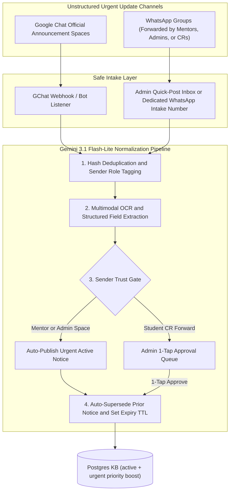
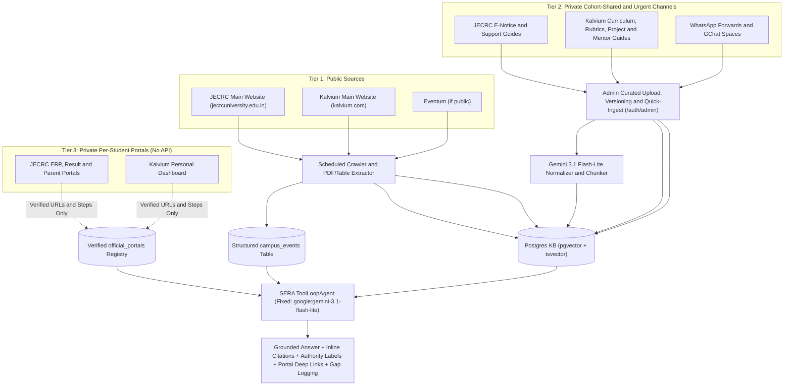

# SERA – Data Sources & Ingestion Architecture

> [!IMPORTANT]
> **No-API Portal Constraint (Confirmed):** No authorized API or OAuth integrations exist for the **Kalvium Student Dashboard** or **JECRC ERP / private university portals**. SERA operates with **zero authenticated scraping** and **zero student credential or session capture**. Private cohort-shared content enters strictly via **administrative/campus-rep curated uploads**, while per-student personal records are handled strictly via **policy guidance and verified portal deep-link handoffs**.

This specification defines how **SERA (Student Enquiry and Research Assistant)** ingests, governs, and retrieves information across official university sources, Kalvium resources, Eventum, and real-time urgent messaging channels for the **Kalvium X JECRC** beta (see [PROBLEM_TREE.md](./PROBLEM_TREE.md)).

---

## 1. Fixed Model & Core System Constraints

- **Fixed Universal LLM:** **Google Gemini 3.1 Flash-Lite** (`google:gemini-3.1-flash-lite`) is enforced universally across all users, search modes (`quick` and `adaptive`), title generation, and multimodal notice parsing. Model selection is disabled in both the UI and runtime configuration (requiring only `GOOGLE_GENERATIVE_AI_API_KEY`).
- **Zero Authenticated Scraping:** SERA never automates logins, stores session cookies, or asks students for ERP/Kalvium credentials.
- **Strict PII Boundary:** Shared cohort information lives in the searchable Knowledge Base; personal per-student information (attendance, grades, fee balances, personal learning progress) is never indexed or cached in shared storage.

---

## 2. Five Core Data Sources & Integration Tiers

SERA organizes its five core sources into three integration tiers based on visibility and personal-data sensitivity.

### 2.1 JECRC Main Website (*Tier 1: Public Web*)

**Source:** [JECRC University Official Website](https://jecrcuniversity.edu.in/)

| Data Category | Ingestion Strategy | Refresh Cadence |
| :--- | :--- | :--- |
| Admission Procedures & Eligibility | Scheduled crawl + PDF/table extraction into Postgres KB | Daily / Weekly |
| Course Details (Programs & Branches) | Scheduled HTML crawl into Postgres KB | Weekly |
| Fee Structure (Course-wise & Hostel) | Structured Markdown/JSON table extraction + effective-year tagging | On academic-year update / Weekly check |
| Academic Calendar & Holiday Lists | PDF/HTML extraction + structured key-date records | Weekly / Term start |
| University Achievements | Scheduled crawl + allowlisted live web fallback | Weekly |
| Events and Activities | Scheduled crawl + cross-reference with Eventum | Daily |

**Fallback:** Allowlisted live search restricted strictly to `include_domains: ["jecrcuniversity.edu.in"]`.

---

### 2.2 JECRC ERP and Notice Portal (*Tier 2 Admin Uploads + Tier 3 Deep Links*)

Because no authorized ERP/portal APIs exist, JECRC internal portals split cleanly between **cohort-shared notices** (curated by admins) and **individual student records** (deep-linked to official portals).

| Portal | Purpose | Tier & Ingestion Strategy | What SERA Answers |
| :--- | :--- | :--- | :--- |
| **ERP Portal** | Student academic information | **Tier 3 (Verified Deep Link)** + Tier 2 FAQ guides | Explains workflows (e.g., registration, fee receipt download, attendance policy) and links directly to the ERP login page for personal records. |
| **E-Notice Portal** | Official university notices | **Tier 2 (Admin Curated Upload)** | Full Q&A with citations over uploaded circulars, exam forms, timetable revisions, and deadline notices tagged with effective dates. |
| **Result Portal** | Examination results | **Tier 3 (Verified Deep Link)** + Tier 2 re-eval/backlog rules | Answers result-release announcements, grading/re-evaluation rules, and hands off directly to the official Result Portal for individual marks. |
| **Student Support Portal** | Student queries and services | **Tier 2 (Admin Upload)** + **Tier 3 (Deep Link)** | Surfaces exact support procedures, SLA contacts, and escalation links when self-service cannot resolve an issue. |
| **Parent Portal** | Parent-related information | **Tier 3 (Verified Deep Link)** + Tier 2 parent FAQs | Guides parents on portal access, fee schedules, and official contact channels with direct portal links. |

---

### 2.3 Kalvium Student Dashboard (*Tier 2 Admin Uploads + Tier 3 Deep Links*)

**Source:** [Kalvium Student Dashboard](https://app.kalvium.community/dashboard)

With no authorized Kalvium API/OAuth integration, cohort-wide academic materials and guidelines are uploaded by Kalvium campus mentors/admins, while personal student progress is routed back to the live dashboard.

| Dashboard Area | Cohort-Shared Content (**Tier 2: Admin / Mentor Upload**) | Per-Student Personal Data (**Tier 3: Verified Deep Link**) |
| :--- | :--- | :--- |
| **Learning Units** | Module directory, topic index, study guides, resource links | Individual unit completion status → Deep link to Dashboard |
| **Assignments** | Assignment FAQs, submission rules, late policies, general guidelines | Personal pending deadlines / submission status → Deep link to Dashboard |
| **Assessments** | Assessment formats, rubrics, grading policies, proctoring/attendance rules | Personal exam scores / attempt status → Deep link to Dashboard |
| **Learning Progress** | Milestone expectations, promotion criteria, attendance/credit rules | Personal progress percentage / standing → Deep link to Dashboard |
| **Projects** | Project briefs, team rules, evaluation rubrics, showcase timelines | Personal team allocation / repo review status → Deep link to Dashboard |
| **Curriculum** | Full curriculum structure, semester/module breakdown, skill tracks | Personalized elective enrollment → Deep link to Dashboard |
| **Mentorship** | Mentor directory, office-hour rules, escalation protocols | Personal mentor pairing / 1:1 booking → Deep link to Dashboard |

---

### 2.4 Eventum (*Structured Event Store*)

Event data changes rapidly and loses accuracy in static text chunks. Eventum data is stored in a structured `campus_events` table with explicit timestamps, deadlines, and venue fields.

| Data Category | Storage & Ingestion Strategy | Notes |
| :--- | :--- | :--- |
| **Upcoming Events** | Structured `campus_events` rows (`start_at`, `end_at`, `status`) | Public web sync if Eventum is publicly reachable, or Admin/Organizer upload in `/auth/admin`. |
| **Event Registration** | `registration_url`, `registration_deadline`, `eligibility` | Automatically stops surfacing expired registration links once `registration_deadline` passes. |
| **Event Schedule** | Structured session timings & milestones | Preserves exact date/time ordering for "What events are happening this week?" queries. |
| **Event Venue** | Structured `venue` / `campus_location` + online link | Avoids chunking splits separating event names from room/auditorium locations. |
| **Participation Guidelines** | Normalized markdown field (`guidelines`) | Captures dress code, team size, prerequisites, and attendance/credit waiver eligibility. |
| **Event Results** | `results_summary` + `results_url` | Marks finished events cleanly and surfaces winners/result links without listing them as upcoming. |

---

### 2.5 Kalvium Main Website (*Tier 1: Public Web*)

**Source:** [Kalvium Official Website](https://kalvium.com/)

| Data Category | Ingestion Strategy | Fallback |
| :--- | :--- | :--- |
| **About Kalvium** | Scheduled crawl into Postgres KB | `searchOfficialWeb` (`include_domains: ["kalvium.com"]`) |
| **Admission** | Eligibility, selection stages, and program structure crawled + table-normalized | `searchOfficialWeb` (`include_domains: ["kalvium.com"]`) |
| **FAQs** | Q&A pairs indexed as self-contained chunks | `searchOfficialWeb` (`include_domains: ["kalvium.com"]`) |

---

### 2.6 Consolidated Integration Matrix

| Source | Access Type | Ingestion Method | Per-Student PII Handling | Precedence Tier |
| :--- | :--- | :--- | :--- | :--- |
| **JECRC E-Notice & Support** | Private (No API) | Admin / Rep Upload (`/auth/admin`) | None indexed | **1 (Highest)** |
| **WhatsApp & GChat Urgent Updates** | Private / Unstructured | GChat Bot + Admin Forward Queue | Filtered out (`noise`/PII dropped) | **1 (Urgent Window)** |
| **Kalvium Dashboard (Shared)** | Private (No API) | Mentor / Admin Upload (`/auth/admin`) | Deep-linked to `app.kalvium.community` | **2** |
| **JECRC ERP / Result / Parent** | Private (No API) | Policy Guides + Verified Deep-Link Registry | Deep-linked only (zero scraping) | **2 (Guides) / N/A (PII)** |
| **Eventum** | Public or Organizer-fed | Public Sync or Admin Structured Entry | None indexed | **3** |
| **JECRC & Kalvium Websites** | Public | Scheduled Crawl + Allowlisted Search | Public info only | **4 (Baseline)** |

---

## 3. Unstructured Urgent Updates Ingestion Flow (WhatsApp & GChat)

Time-sensitive operational changes (cancelled classes, room swaps, extended fee deadlines, last-minute exam notices) are currently shared as unstructured messages across **WhatsApp groups** and **Google Chat (GChat)**. SERA captures these safely without violating platform terms or polling personal chats.

### 3.1 Channel Capture Mechanisms

1. **Google Chat (GChat) — Automated Space Capture**
   - Add a lightweight **SERA GChat Webhook / Bot App** exclusively to designated official announcement spaces (for example, `#kalvium-jecrc-announcements` or `#squad-updates`).
   - Trigger capture on messages posted inside broadcast-only announcement spaces or via explicit `@SERA capture` / slash command in mixed spaces so casual student chatter is ignored.
   - Pull message text, thread parent context (crucial for corrections like *"Updated room: C-204"*), sender identity, timestamp, and attached PDFs/images.
2. **WhatsApp Groups — Ban-Safe Forward & Quick-Ingest Flow**
   - **Zero unofficial WhatsApp Web scraping:** Unofficial automated scrapers risk account bans and expose private peer messages.
   - **Admin / CR Quick-Ingest Inbox (Beta Day 1):** A mobile-optimized **Quick Post** card inside `/auth/admin` where mentors, admins, or designated class representatives (CRs) paste a WhatsApp forward or upload a notice screenshot/PDF in under 10 seconds.
   - **Optional Phase 2 Dedicated Intake Number:** An official WhatsApp Cloud API (or Twilio) intake number where authorized campus reps forward announcements directly from WhatsApp; SERA replies with a preview card (`Approve / Edit Cohort / Reject`).

### 3.2 Five-Stage Processing & Governance Pipeline

1. **Deduplicate & Tag Provenance:** Compute a normalized content hash + time window to prevent duplicate ingestion when the same circular hits both WhatsApp and GChat. Attach `channel` (`gchat | whatsapp_forward`), `senderRole`, and `capturedAt`.
2. **Triage & Multimodal Extraction (`Gemini 3.1 Flash-Lite`):**
   - Classify message intent (`urgent_notice | timetable_change | exam_update | fee_deadline | event | noise`). Messages classified as `noise` or containing personal student data are discarded immediately.
   - Use Gemini 3.1 Flash-Lite multimodal input to transcribe forwarded notice **screenshots, posters, and PDFs** into clean Markdown.
   - Extract structured metadata: `domain`, `authority` (`kalvium | jecrc | joint`), `cohort/squad/semester`, `effectiveDate`, `expiresAt`, `actionRequired`, and `supersedesTopic`.
3. **Sender Trust Gate:**
   - **Trusted Mentors / Admins / Broadcast GChat Spaces:** Auto-publish immediately with `status = 'active'` and `priority = 'urgent'` so SERA reflects room changes or cancellations within seconds.
   - **Student CR Forwards:** Enter a **Pending Review** queue in `/auth/admin` (or a GChat confirmation card) requiring 1-tap approval before going live, blocking unverified rumors (`Q2.3`, `Q5.3`).
4. **Auto-Supersede & Ephemeral TTL Expiry:**
   - When a notice updates an earlier message (for example, a rescheduled slot or revised room), matching active notices for the same cohort/topic/date are automatically transitioned to `status = 'superseded'` via `supersedesId`.
   - Short-lived notices carry an explicit `expiresAt` timestamp (e.g., end-of-day for *"Today's 2 PM session moved to Lab 3"*) so stale daily alerts automatically drop out of retrieval.
5. **Retrieval Priority & Provenance Badge:**
   - Active urgent updates inside `[effectiveDate, expiresAt]` receive a retrieval boost in `searchCampusKnowledge` and render inline with their exact source channel and timestamp (e.g., *"Urgent Update · GChat Announcement · Nov 23, 10:15 AM"*).

---

## 4. End-to-End Ingestion & Query Architecture

---

## 5. Postgres Schema & Agent Tooling Plan

### 5.1 Planned Drizzle Tables (Extending `lib/db/schema.ts`)

1. **`knowledge_documents` & `knowledge_chunks`**
   - Document metadata: `title`, `domain` (`admissions | fees | examinations | timetables | activities | academics | general`), `sourceSystem` (`jecrc_web | jecrc_enotice | jecrc_portal_guide | kalvium_web | kalvium_guide | whatsapp_forward | gchat_space | eventum`), `authority` (`kalvium | jecrc | joint`), cohort filters (`program`, `semester`, `squad`, `residency`), `priority` (`standard | urgent`), `effectiveDate`, `expiresAt`, `status` (`active | pending_review | superseded | archived`), `supersedesId`, `sourceUrl`, `uploadedBy`.
   - Hybrid retrieval in Postgres via **`pgvector`** semantic similarity + **`tsvector`** full-text search (no separate vector database required), preserving Markdown/JSON tables intact for fee charts and timetables.
2. **`campus_events`**
   - Structured Eventum records: `title`, `organizer`, `startAt`, `endAt`, `venue`, `registrationDeadline`, `registrationUrl`, `eligibility`, `guidelines`, `resultsSummary`, `resultsUrl`, `status`.
3. **`official_portals`**
   - Deterministic registry for Tier 3 handoffs: `portalKey`, `name`, `authority`, `url`, `requiresLogin`, `capabilities`, `navigationSteps`, `supportContact`, `lastVerifiedAt`.
4. **`unanswered_queries` & Citation Feedback Flags**
   - Logs every abstention (`query`, `domain`, `cohort`, `reason`) plus 1-tap **"Wrong / Outdated?"** flags linked to `documentId` for weekly admin review.

### 5.2 SERA `ToolLoopAgent` Tools (`lib/agents/researcher.ts`)

1. **`searchCampusKnowledge` (Primary — Always First):** Hybrid search across `active` KB documents filtered by validity dates (`expiresAt IS NULL OR expiresAt > now()`), urgent priority boost, and student cohort context; emits `[1](#label)` citations displaying **Authority + Document Title + Effective Date**.
2. **`queryEvents`:** Date-aware structured query over `campus_events` for upcoming events, registration deadlines, venues, guidelines, and results.
3. **`getOfficialPortalLinks`:** Deterministic lookup from `official_portals` returning verified URLs and step-by-step instructions for ERP, Result, Parent, Student Support, and Kalvium Dashboard actions (zero guessed URLs).
4. **`searchOfficialWeb` (Controlled Fallback):** Wraps `lib/tools/search.ts` with hardcoded `include_domains: ["jecrcuniversity.edu.in", "kalvium.com"]` (plus Eventum if public) — blocks third-party aggregators and visually distinguishes web fallback results from admin-verified campus documents.

### 5.3 Source Precedence & Guardrails

When sources conflict, SERA resolves priority in strict descending order:
1. **Active Urgent Updates** (GChat / Admin-approved WhatsApp forwards within TTL)
2. **Latest Admin-Verified JECRC E-Notice / Campus Circular** (by `effectiveDate`)
3. **Admin-Verified Kalvium Curriculum, Assessment & Mentorship Guides**
4. **Structured Eventum Records** (`campus_events`)
5. **Public Websites** (`jecrcuniversity.edu.in`, `kalvium.com` — KB crawl first, allowlisted live search second)

- **Dual-Entity Disambiguation:** Whenever a policy differs between **Kalvium** and **JECRC University** (e.g., attendance, exam forms, academic calendar), SERA separates both authorities explicitly rather than blending them.
- **Strict Abstention:** When verified info is missing, expired, or contradictory, SERA abstains instead of guessing, provides the exact human escalation contact or verified portal link, and logs the gap to `unanswered_queries`.

---

## 6. Current Repository Status & Open Decisions

### 6.1 Repository Status Snapshot

- **Documentation:** [PROBLEM_TREE.md](./PROBLEM_TREE.md), [CONFIGURATION.md](./CONFIGURATION.md), and this specification (`DATA_SOURCES.md`) are in place.
- **Model Configuration & UI Lock-In:** User model selection is removed from the UI and configuration; `google:gemini-3.1-flash-lite` is enforced universally across `config/models/cloud.json`, `lib/config/default-model.ts`, `lib/utils/model-selection.ts`, `app/` pages, and `.env.local.example`.
- **Existing Foundation Ready to Reuse:** Streaming `ToolLoopAgent` + inline citations (`lib/agents/`), Better Auth invite-only beta onboarding & `/auth/admin` (`app/auth/admin/page.tsx`), Drizzle + Postgres RLS + `tsvector` (`lib/db/schema.ts`), R2/S3 file uploads (`app/api/upload/route.ts`), feedback persistence, and Vitest/`evals/` harnesses.
- **Not Yet Implemented (Next Engineering Sprint):** SERA Postgres KB/event/portal/urgent-queue tables + `pgvector` migration, Admin Knowledge Manager & Quick-Ingest UI in `/auth/admin`, GChat webhook endpoint, `searchCampusKnowledge` / `queryEvents` / `getOfficialPortalLinks` tools, student cohort selector, and Kalvium X JECRC eval dataset.

### 6.2 Open Decisions Before Sprint 1 Coding

1. **Eventum Access & URL:** What is Eventum's URL, and can we sync public event pages/JSON automatically or should organizers manage it via `/auth/admin`?
2. **Campus Uploaders & GChat Space Setup:** Who are the designated Kalvium mentors / JECRC reps who will own `/auth/admin` uploads and approve student-CR WhatsApp forwards, and which GChat Spaces should the webhook listen to?
3. **Database & Storage Hosting:** Will the beta deploy on **Supabase Postgres** (with `pgvector` enabled natively) or self-hosted **Docker Postgres** (`pgvector/pgvector:pg17` image), and is Cloudflare R2/S3 configured for storing uploaded PDF/image circulars?
