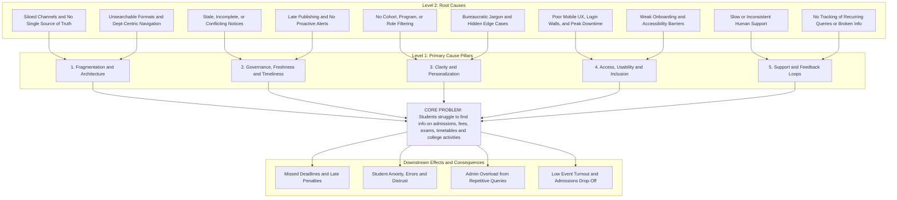
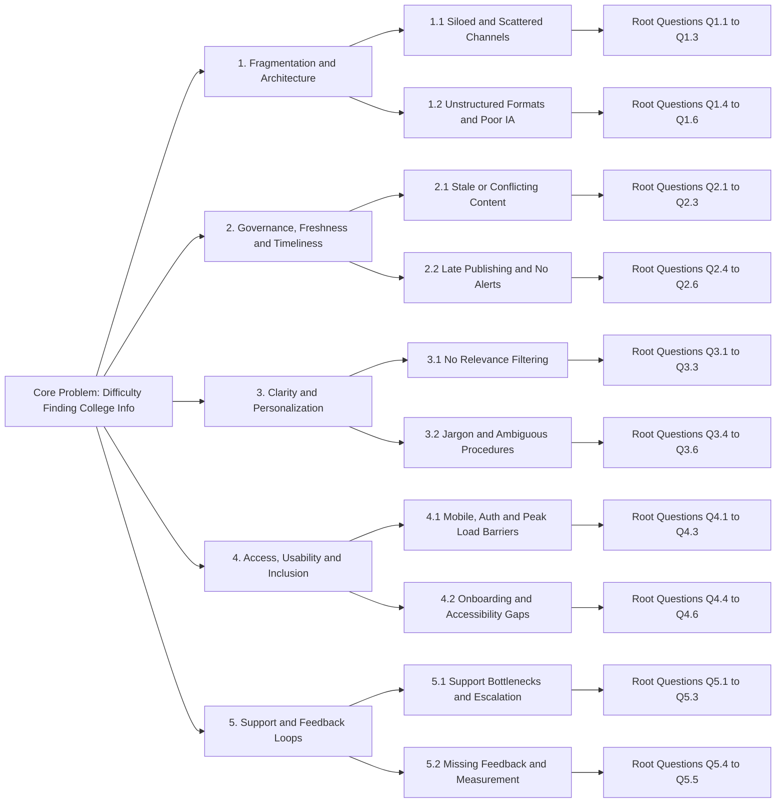

# Problem Tree & Root Question Decomposition: Student Information Access

> [!IMPORTANT]
> **Core Problem Statement:** "Students often have difficulty finding information about admissions, fees, examinations, timetables and college activities."

---

## 1. Problem Framing & Scope

Before diagnosing causes, the problem statement breaks down across **who** experiences the friction, **what** information they seek, and **how** "difficulty" manifests.

| Dimension | Breakdown |
| :--- | :--- |
| **Affected Personas** | **Prospective students & parents/guardians** (pre-enrollment discovery & application), **First-year / incoming students** (onboarding & system orientation), **Continuing students** (ongoing academic, financial, & campus life) |
| **Information Domains (5)** | 1. **Admissions**, 2. **Fees**, 3. **Examinations**, 4. **Timetables**, 5. **College Activities** |
| **Dimensions of "Difficulty"** | **Discoverability** (knowing where it lives), **Timeliness** (receiving it before deadlines), **Trust / Accuracy** (knowing it is current and official), **Relevance / Comprehension** (knowing what applies to them), **Access** (reaching it on their device, network, or ability) |

---

## 2. Visual Problem Tree (Causes → Core Problem → Effects)

The problem tree below maps root causes (bottom/top inputs) through five primary causal pillars into the core problem and its institutional and student consequences.

---

## 3. Root Question Decomposition Tree (MECE Issue Tree)

To investigate the problem systematically without overlaps or blind spots (Mutually Exclusive, Collectively Exhaustive), each primary cause pillar branches into specific diagnostic root-question clusters.

---

## 4. Detailed Root Questions by Branch (MECE)

### Branch 1: Information Fragmentation & Publishing Architecture
*Diagnostic focus: Where does information live, and can it be located?*

#### 1.1 Siloed & Scattered Channels
- **Q1.1:** Where is the official "source of truth" for each of the 5 domains, and do students know it?
- **Q1.2:** How many separate channels (website, ERP/LMS, email, WhatsApp/Telegram, social media, physical notice boards, department desks) must a student monitor to avoid missing updates?
- **Q1.3:** Why do departments, exam cells, finance offices, and student clubs publish independently rather than through a unified channel?

#### 1.2 Unstructured Formats & Poor Information Architecture
- **Q1.4:** Are notices and schedules published as searchable structured content, or locked inside scanned PDFs, images, and unindexed attachments?
- **Q1.5:** Is website/portal navigation organized around internal college departments (org-chart structure) instead of student tasks and lifecycle stages?
- **Q1.6:** Does an effective cross-channel search exist, and why do common student queries fail to return relevant results?

---

### Branch 2: Information Governance, Accuracy & Timeliness
*Diagnostic focus: Is the information current, consistent, and delivered in time?*

#### 2.1 Stale, Incomplete, or Conflicting Content
- **Q2.1:** Who owns creating, updating, and retiring content for each domain, and what workflow triggers an update?
- **Q2.2:** Why do outdated documents (prior-year fee charts, old academic calendars, superseded timetables) remain live alongside current ones?
- **Q2.3:** How can a student verify whether a notice or schedule is the latest authoritative version when two channels contradict each other?

#### 2.2 Late Publication & Lack of Proactive Alerts
- **Q2.4:** What is the lag between an administrative decision (exam date, fee deadline, room change, event approval) and its publication to students?
- **Q2.5:** How are urgent or last-minute changes (cancelled classes, rescheduled exams, extended deadlines) pushed to affected students?
- **Q2.6:** Why must students repeatedly "pull" (manually check portals/boards) instead of receiving targeted, deadline-aware notifications?

---

### Branch 3: Content Clarity, Personalization & Context
*Diagnostic focus: Can students quickly tell what applies to them and what action to take?*

#### 3.1 Lack of Relevance Filtering & Personalization
- **Q3.1:** How easily can a student isolate information specific to their program, semester, section/batch, elective choices, or admission/fee category?
- **Q3.2:** Why are monolithic institution-wide circulars and master spreadsheets issued instead of personalized or filterable views?
- **Q3.3:** How do students separate high-priority mandatory notices (exams, fees) from high-volume optional announcements (clubs, events)?

#### 3.2 Bureaucratic Language & Ambiguous Procedures
- **Q3.4:** Are notices written in plain, action-oriented language (eligibility, exact steps, required documents, deadlines, payment/registration links) or administrative jargon?
- **Q3.5:** Where are exceptions and edge cases documented (scholarships, installment waivers, late-fee appeals, supplementary/re-exams, transfer credits)?
- **Q3.6:** Do multi-step processes clearly state prerequisites, next steps, and confirmation/receipt expectations?

---

### Branch 4: Access, Usability & Inclusion Barriers
*Diagnostic focus: Can every student actually reach and use the information?*

#### 4.1 Technical, Mobile & Authentication Barriers
- **Q4.1:** What proportion of students primarily rely on mobile phones, and are portals, tables, and timetables usable on small screens and low-bandwidth networks?
- **Q4.2:** Which critical public resources (admission rules, fee structures, academic calendars, campus activities) are unnecessarily hidden behind student login walls, blocking prospective students and parents?
- **Q4.3:** Do information systems experience downtime or slowdowns during peak windows (admissions, fee deadlines, exam form submission, result release)?

#### 4.2 Onboarding, Digital Literacy & Accessibility
- **Q4.4:** How and when are prospective and newly admitted students taught which portals, credentials, and channels they are expected to use?
- **Q4.5:** Are documents and portals accessible to students with disabilities (screen-reader friendly, semantic HTML, alt text) and to students/parents with different language proficiencies?
- **Q4.6:** How do students without reliable personal devices or campus Wi-Fi access time-sensitive notices?

---

### Branch 5: Support, Escalation & Continuous Improvement Loops
*Diagnostic focus: What happens when self-service fails, and does the system learn from it?*

#### 5.1 Support Bottlenecks & Escalation Gaps
- **Q5.1:** When students cannot find or confirm an answer online, what escalation path exists (helpdesk, email, phone, office window), and what are its response times and resolution rates?
- **Q5.2:** Why do different offices or staff members sometimes provide conflicting verbal answers to the same student query?
- **Q5.3:** How much of students' reliance on peers, seniors, or unofficial WhatsApp groups is caused by distrust or friction in official support channels?

#### 5.2 Missing Feedback & Measurement
- **Q5.4:** Does the institution track top search terms, zero-result queries, and recurring helpdesk/counter questions to identify and fix missing documentation?
- **Q5.5:** Is there an easy way for students to flag broken links, outdated PDFs, or ambiguous notices and see them corrected?

---

## 5. Domain-Specific Root Questions Matrix

While the five branches above reveal systemic causes, each information domain exhibits distinct failure modes and requires targeted inquiry:

| Domain | Primary Audience | Typical Failure Modes | Domain-Specific Root Questions |
| :--- | :--- | :--- | :--- |
| **Admissions** | Prospective students & parents | Buried eligibility/cutoff rules, unclear application timelines, login-gated info, opaque merit/seat status | 1. Can a prospective student find exact eligibility, cutoffs, and required documents per program without creating an account? 2. How clearly are admission rounds, counseling schedules, and waitlist/seat-allotment updates communicated? 3. Where do applicants track application status and get pre-admission queries answered quickly? |
| **Fees** | Prospective students, current students & parents | Hidden/fragmented breakdowns (tuition vs. hostel/exam/misc), unclear quota/scholarship adjustments, late-fee surprises, missing receipts | 1. Is the complete itemized cost visible upfront by program, admission quota, and residency/hostel status? 2. Are payment methods, installment rules, scholarship/waiver deductions, and late-fee penalties unambiguous? 3. How quickly can a student verify payment confirmation and retrieve official receipts? |
| **Examinations** | Current students | Late exam-form windows, scattered hall-ticket links, unclear seating/syllabus rules, opaque re-evaluation & supplementary procedures | 1. Do students receive timely, consolidated clarity on exam registration deadlines, eligibility/attendance cutoffs, and hall-ticket release? 2. How easily can students locate seat numbers, room assignments, permitted materials, and last-minute schedule changes? 3. Are supplementary/backlog exam rules, re-evaluation steps, and result portals clearly linked in one place? |
| **Timetables** | Current students & faculty | Multi-page PDFs/Excel sheets, elective clashes, unannounced room or faculty swaps, broken mobile rendering | 1. Can a student view a personalized timetable filtered by semester, section, lab batch, and electives on mobile? 2. How quickly are room changes, class cancellations, or makeup sessions reflected and notified to affected batches? 3. Why do official timetables frequently lag behind actual department/faculty scheduling changes? |
| **College Activities** | Current & prospective students | Siloed Instagram/poster announcements, no central calendar, missing registration/eligibility details, unclear attendance/credit rules | 1. Is there a single searchable calendar covering academic, cultural, technical, and club events across departments? 2. Do event notices consistently include registration links, deadlines, prerequisites, fees, and venue details? 3. Do students know whether participation grants academic credit or attendance waivers, and how to claim them? |

---

## 6. How to Answer These Root Questions (Discovery & Validation Guide)

To move from problem decomposition to evidence-backed diagnosis at a specific institution, pair each root-question cluster with an appropriate discovery method:

| Research Method | Target Root Questions | Evidence to Collect |
| :--- | :--- | :--- |
| **Channel & Content Audit** | `Q1.1–Q1.6`, `Q2.2–Q2.3`, `Q3.4–Q3.6`, `Q4.1–Q4.2`, `Q4.5` | Inventory of all active channels; ratio of HTML vs. scanned PDFs/images; count of conflicting or outdated files; mobile usability & WCAG/accessibility checks; login-wall audit for public info. |
| **Student & Parent Interviews / Contextual Inquiry** | `Q1.1–Q1.2`, `Q2.5–Q2.6`, `Q3.1`, `Q3.3`, `Q4.4`, `Q4.6`, `Q5.3` | Screen-share / task-completion observation (finding fee due dates, exam rules, timetables); count of unofficial WhatsApp/peer workarounds; drop-off points and jargon confusion. |
| **Admin & Staff Stakeholder Mapping** | `Q1.3`, `Q2.1`, `Q2.4`, `Q3.2`, `Q5.1–Q5.2` | Publishing workflow map across registrar, finance, exam cell, departments, and clubs; approval-to-publish lag times; causes of conflicting verbal guidance across desks. |
| **Support Log & Portal Analytics Review** | `Q1.6`, `Q4.3`, `Q5.1`, `Q5.4–Q5.5` | Top site-search terms and zero-result queries; helpdesk/email/counter ticket volume by domain and month; server error/latency logs during peak admissions, fee, and exam windows. |
